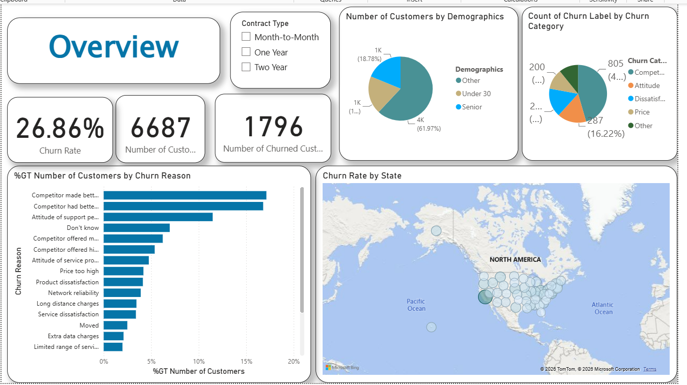
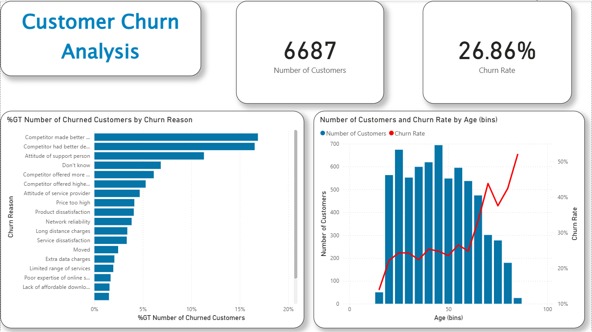
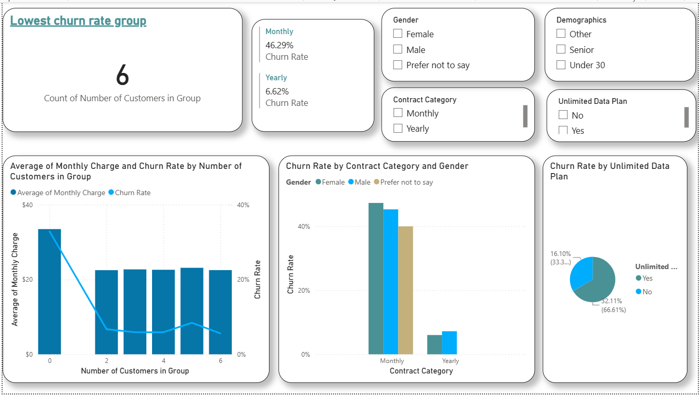
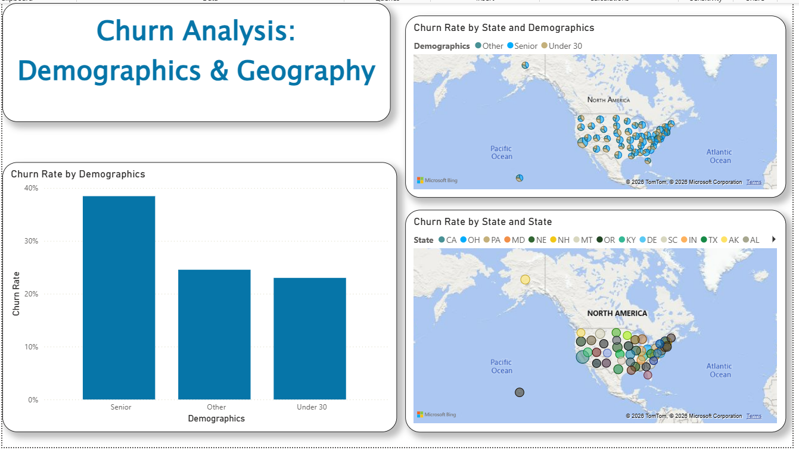

# 📉 Telecom Customer Churn Analysis (Power BI)

An interactive Power BI dashboard that analyzes why customers leave **Databel**, a telecom provider, and which customer groups are most at risk. The goal is to turn raw customer data into clear, actionable retention insights.



---

## 📌 Business Problem

Losing customers is expensive: acquiring a new customer costs far more than keeping an existing one. Databel's management wants to answer:

1. **How big is the churn problem?**
2. **Why are customers leaving?**
3. **Which customers are most likely to leave?** (contract, age, group membership, plan, location)
4. **Who are the most loyal customers, and what do they have in common?**

---

## 📊 Dataset

- **File:** [`data/Databel - Data.csv`](Databel%20-%20Data.csv)
- **Size:** 6,687 customers × 29 columns
- **Target:** `Churn Label` (Yes / No)
- **Includes:** account length, local and international usage, data plan, contract type, payment method, monthly and total charges, age, gender, state, group membership, customer service calls, and for churned customers a **churn category** and **churn reason**.

> Source: _add where the dataset came from (course, website, or link)._

---

## 🛠️ Tools & Skills

| Area | Details |
|---|---|
| **Tool** | Microsoft Power BI Desktop |
| **Data prep** | Power Query (cleaning and transformation) |
| **Modeling** | Calculated columns (`Demographics`, `Age (bins)`, `Contract Category`) and a dedicated `_Calculations` measures table |
| **DAX measures** | `Churn Rate`, `Number of Customers`, `Number of Churned Customers` |
| **Visuals** | KPI cards, bar / column / pie charts, line-and-column combo charts, map visuals, slicers |

---

## 🗂️ Dashboard Pages

### 1. Overview
High-level KPIs (churn rate, total customers, churned customers), churn by category, the top churn reasons, customer breakdown by demographic segment, and a state-level churn map. A **Contract Type** slicer lets you filter the whole page.


### 2. Customer Churn Analysis
Focuses on **why** customers leave and how churn changes with **age**. The combo chart shows the customer count by age bin against the churn rate.



### 3. Who Are Our Most Loyal Customers?
Looks at the lowest-churn groups. It compares churn by contract category, gender, unlimited data plan, and group size, with slicers for each.



### 4. Churn Analysis: Demographics & Geography
Compares churn across Senior, Under 30 and Other customers, and shows how it varies by state.



---

## 🔍 Key Findings

| # | Finding | Evidence |
|---|---|---|
| 1 | **Roughly 1 in 4 customers has churned.** | 1,796 of 6,687 customers, a churn rate of **26.86%** |
| 2 | **Competitors are the main reason customers leave.** | Competitor-related reasons account for **805 of 1,796** churned customers. The top reasons are "Competitor made better offer" (303) and "Competitor had better devices" (297). |
| 3 | **Poor support experience is the next biggest driver.** | "Attitude of support person" is the third most common reason (203 customers). |
| 4 | **Contract type is the strongest segment signal.** | Month-to-month customers churn at about **46%**, versus about **7%** for yearly (one- and two-year) contracts. |
| 5 | **Seniors churn much more than other age groups.** | Seniors churn at about **38%** versus about **23%** for under-30s. Churn rises steeply for customers above 65. |
| 6 | **Customers in a group are far more loyal.** | About **6.5%** churn for customers in a group versus about **33%** for those who are not. |
| 7 | **Unlimited data plan customers churn about twice as often.** | About **32%** churn with an unlimited data plan versus about **16%** without one. |
| 8 | **Churn is not evenly spread across states.** | California shows the highest rate on the map. Small states have few customers, so their rates should be read with care. |

---

## 💡 Recommendations

1. **Move month-to-month customers to longer contracts.** Offer discounts or perks for 1- or 2-year plans. This is the biggest gap in churn rates.
2. **Counter competitor offers.** Competitor offers and devices drive most churn, so review device deals, data allowances and promotional pricing.
3. **Invest in support quality.** Train support teams on customer interaction, since "attitude of support person" is a top-three churn reason.
4. **Promote group and family plans.** Customers in groups churn far less, so make joining a group easy and attractive.
5. **Build a retention program for senior customers.** Offer simpler plans, dedicated support, and proactive check-ins.
6. **Review the unlimited data plan.** Find out why its customers leave more often (price, speed, or competitor offers).

---

## 🚀 Future Improvements

- Add analysis of **customer service calls**, **tenure (account length)** and **payment method**. These are not yet in the dashboard, and early checks on the raw data suggest they are strong churn signals.
- Add a **churn risk segment** (high / medium / low) based on these factors.
- Add tooltips showing customer counts, so small-sample states are not over-interpreted.
- Build a predictive model (for example, logistic regression or random forest) to score customers by churn probability.

---

## ▶️ How to Open the Project

1. Install [Power BI Desktop](https://powerbi.microsoft.com/desktop/) (free, Windows).
2. Clone or download this repository.
3. Open `Churn_rate_project.pbix`.
4. If Power BI asks for the data source, point it to `data/Databel - Data.csv`.

---

## 📁 Repository Structure

```
├── Churn_rate_project.pbix      # Power BI report
├── data/
│   └── Databel - Data.csv       # Dataset
├── images/                      # Dashboard screenshots
│   ├── 01-overview.png
│   ├── 02-customer-churn-analysis.png
│   ├── 03-loyal-customers.png
│   └── 04-demographics-geography.png
└── README.md
```

---

## 👤 Author

**Abdelmalek**
- GitHub: [@Malek-bit](https://github.com/Malek-bit)
- LinkedIn: https://www.linkedin.com/in/abdelmalek-mamdouh-2578b128a/

⭐ If you found this project useful, feel free to star the repo!
